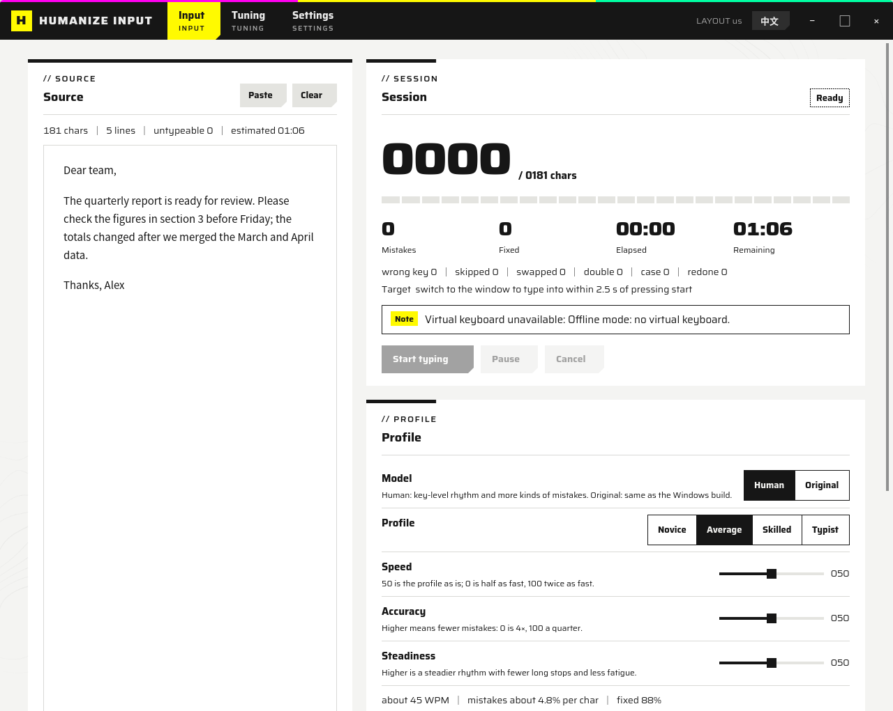

# humanize_input · Linux

Types text into any window like a person — with rhythm, pauses and mistakes that get fixed — through a virtual USB keyboard. A native Linux rewrite of the Windows (C# / WPF) app in Rust and GTK4, aimed at KDE Plasma on Wayland or X11.

中文说明：[README.zh-CN.md](README.zh-CN.md)



## Features

- **Hardware-level keys.** A uinput virtual USB keyboard that looks like a regular one: BUS_USB, configurable name and VID/PID, 105 keys, HID scan codes, the three lock LEDs. Key events go out in USB-polling-rate reports (1000 Hz by default), ordered as a real keyboard orders them.
- **Your keyboard layout.** Reads the layout KDE is using (US, German, French, Dvorak, …) and works out which key — with Shift or AltGr — produces each character. Follows layout switches.
- **Human model** (default):
  - Keys: each key is held for its own time; fast typing overlaps keys; Shift comes from the other hand.
  - Rhythm: intervals depend on fingers and letter pairs; pauses at sentences, paragraphs and now and then; gradual fatigue.
  - Mistakes: wrong key, skipped or swapped characters, double presses, Shift slips, fumbled words erased and retyped. Each is fixed or left according to the fix rate, sometimes only after typing a little further.
  - Profiles and sliders: four profiles (Novice, Average, Skilled, Typist) with speed, accuracy and steadiness sliders. All 28 values can be edited on the Tuning page and exported or imported as TOML.
- **Original model.** The Windows build's behaviour, kept as an option.
- **Types only where you meant:**
  - The window in front when the countdown ends becomes the target. Typing pauses when it loses focus and resumes when it is back (via KWin).
  - Every key is released on pause, focus loss, cancel or error, so Shift never stays stuck.
  - If fcitx5 is in Chinese mode, it is switched to direct input for the target and restored afterwards.
  - Typing refuses to start while Caps Lock is on, which would invert letter case.
- **Global hotkeys** (XDG GlobalShortcuts portal): start `Ctrl+Alt+S`, pause/resume `Ctrl+Alt+P`, cancel `Ctrl+Alt+Q`.
- Tray icon, Chinese and English interface, light and dark themes (following the system by default), settings saved automatically.

## Limitations

- **ASCII only for now:** letters, digits, keyboard symbols, newline and Tab. Other characters (Chinese, full-width punctuation, é, …) are marked in the text and must be removed or replaced before typing starts.
- **Focus detection and hotkeys need KDE Plasma.** Elsewhere the app still types, but it will not pause on focus loss and may have no global hotkeys.
- **Focus detection lags by a few milliseconds:** KWin reports focus changes over DBus, so if focus is suddenly taken while typing (a notification popping up, say), a few keys can land in the other window.
- **Dead keys:** characters that sit on dead keys (such as `^` and `` ` `` on German layouts) are not supported.
- **Word deletion in terminals:** most terminals treat Ctrl+Backspace as a plain Backspace, so word deletion defaults to Auto: one Backspace per character in terminals, Ctrl+Backspace elsewhere.

## Install

### Arch / CachyOS

```sh
cd linux/packaging/arch
makepkg -si   # builds the tagged release (linux-v<version>)
```

The package also installs a udev rule that lets the logged-in user use `/dev/uinput`, a modules-load entry for `uinput`, and the desktop file. If the app still reports no access to `/dev/uinput` right after installing, log out and back in.

### Prebuilt binary (any distribution, x86_64)

Download `humanize_input-linux-v<version>-x86_64.tar.gz` from [Releases](https://github.com/Eric-1029/humanize_input/releases), extract it, then:

```sh
sudo install -Dm644 60-humanize-input-uinput.rules /usr/lib/udev/rules.d/60-humanize-input-uinput.rules
sudo modprobe uinput && sudo udevadm control --reload && sudo udevadm trigger --sysname-match=uinput
./humanize_input
```

It needs GTK 4.16+, libxkbcommon and fontconfig on the system. To start it from the application menu, put `humanize_input` on your `PATH` (e.g. `~/.local/bin`) and copy `dev.humanize_input.HumanizeInput.desktop` to `~/.local/share/applications/`.

### From source

Needs Rust 1.88+ and the development files for GTK 4.16+, libxkbcommon and fontconfig.

```sh
cd linux
cargo build --release -p humanize-input-app
./target/release/humanize_input
```

Check that you can write `/dev/uinput` (`ls -l /dev/uinput` should end in `+`, an ACL). If not, install the udev rule and reload:

```sh
sudo install -Dm644 packaging/60-humanize-input-uinput.rules /usr/lib/udev/rules.d/
sudo modprobe uinput && sudo udevadm control --reload && sudo udevadm trigger --sysname-match=uinput
```

When run from a build tree, the app writes a hidden desktop file to `~/.local/share/applications/`. Desktop portals need it to recognise the app; without it they refuse to register hotkeys. The app also moves itself into its own systemd scope with `systemd-run --scope`.

## Use

1. Paste text into Source, or start with `humanize_input --text FILE`.
2. Pick a profile and adjust the sliders if you like. The estimated typing time is shown above the text.
3. Press Start typing or `Ctrl+Alt+S`. During the countdown (2.5 s by default), switch to the target window and put the cursor where the text should go.
4. `Ctrl+Alt+P` pauses or resumes, and `Ctrl+Alt+Q` cancels. In the Source box, typed text returns to normal colour and a yellow cursor marks the current position.

On first start KDE asks you to confirm the three hotkeys. To change them later, use Change on the Input page or System Settings → Keyboard → Shortcuts.

Closing the window only hides it to the tray; quit from the tray menu.

## Settings file

Settings live in `~/.config/humanize_input/config.toml` and are saved as you change them. Missing or unknown fields fall back to defaults.

| Key | Meaning |
| --- | --- |
| `language` | `zh-CN` / `en-US` |
| `theme` | `system` / `light` / `dark` |
| `model` | `human` / `classic` |
| `preset`, `[macros]` | Profile and the three sliders (`speed`, `accuracy`, `stability`; 50 = profile as is) |
| `[advanced]` | Custom values from the Tuning page; when present they replace the profile, and the sliders adjust on top of them |
| `[classic]` | Original model values |
| `word_delete` | `auto` / `ctrl_backspace` / `backspaces` |
| `lead_in_ms` | Countdown before typing |
| `[hotkeys]` | Suggested combinations; the ones set in KDE win |
| `[device]` | Virtual keyboard `name`, `vendor`, `product`, `version`, `polling_hz` (applied at next start) |
| `start_minimized`, `switch_input_method` | Start in the tray; switch the input method while typing |

## Development

```
linux/
  crates/core      typing models (original + human), session, virtual editor for tests
  crates/keymap    characters → keys via xkbcommon
  crates/input     uinput USB keyboard, recording dry-run driver
  crates/desktop   KWin focus, fcitx5, KDE layout, portal hotkeys, tray, settings
  app/             GTK4 interface
  tools/e2e        live checks (they really type on your desktop)
  packaging/       desktop file, udev rule, PKGBUILD
  docs/PLAN.md     phased plan with a record of each phase
```

```sh
cargo test --workspace                                        # everything that does not touch the system
cargo test -p humanize-input --test device -- --ignored       # creates a real virtual device (sends no keys)
cargo run -p humanize-core --example plan -- average "Hi!"   # prints the key timeline, sends nothing
cargo run -p humanize-e2e                                     # types into its own window and compares
```

Options for interface work: `--offline` (no desktop services or virtual keyboard), `--demo` (types into a recording driver), `--screenshot FILE.png`, `--theme`, `--lang`, `--page`. Setting `HUMANIZE_INPUT_TRACE=FILE` records every key event sent; replay it with `cargo run -p humanize-e2e --bin replay -- FILE`.

## License

Code: MIT (see `LICENSE` at the repository root). Interface font Saira: SIL Open Font License 1.1, see `assets/fonts/Saira-OFL.txt`.
