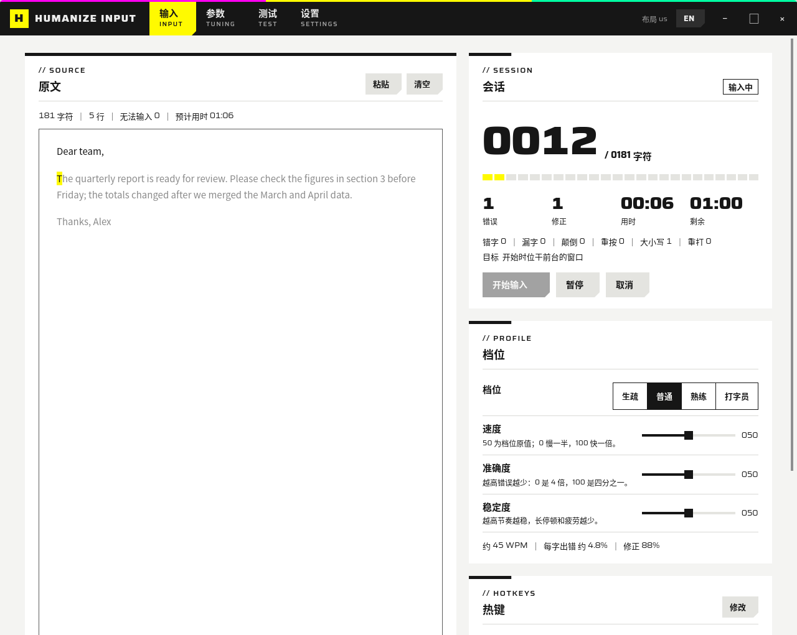
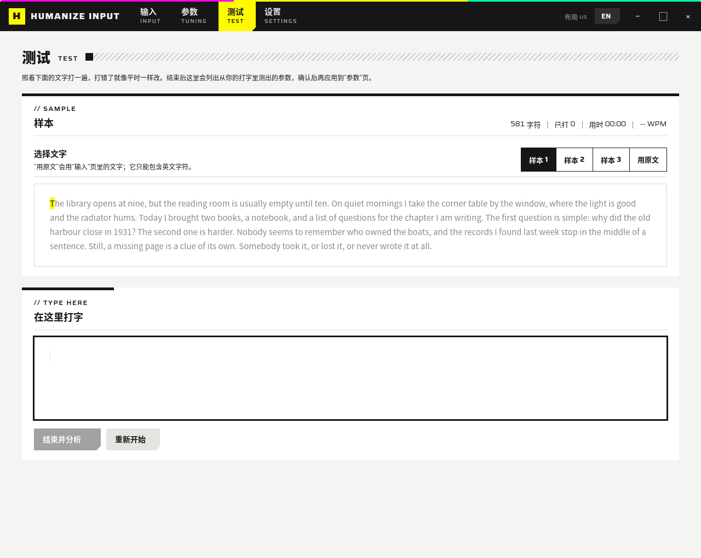

# humanize_input · Linux 版

通过一块虚拟 USB 键盘，像人一样把文字打进任意窗口：有节奏、会停顿、会打错再改。这是 Windows 版（C# / WPF）的 Linux 原生重写，使用 Rust 和 GTK4，主要面向 KDE Plasma（Wayland 或 X11）。

English: [README.md](README.md)



## 功能

- **硬件级按键**：通过 uinput 创建一块虚拟 USB 键盘，系统看到的是一块普通键盘：BUS_USB、可配置的设备名和 VID/PID、105 键、HID 扫描码、三个锁定灯。按键按 USB 轮询率（默认 1000 Hz）成组发出，组内顺序和真实键盘一致。
- **按当前键盘布局打字**：读取 KDE 当前使用的布局（US、德语、法语、Dvorak 等），算出每个字符该按哪个键、要不要 Shift 或 AltGr。在 KDE 里切换布局后自动跟着换。
- **拟人模型**（默认）：
  - 按键：每个键按住多久各不相同；快打时前一个键还没抬起，下一个已经按下；Shift 用另一只手按。
  - 节奏：按手指和字母组合调整间隔；句末、段落和偶尔的长时间停顿；越打越累。
  - 错误：错字、漏字、颠倒、多按一次、大小写失误、整词打乱后删掉重打；按修正率决定改不改，有时多打一两个字才发现。
  - 档位与滑块：四档预设（生疏、普通、熟练、打字员），加上速度、准确度、稳定度三个滑块；全部 28 项数值可以在"参数"页调整，并导出或导入为 TOML。
- **原版模型**：和 Windows 版的行为一致，作为可选模式保留。
- **不打错地方**：
  - 倒计时结束时，把位于前台的窗口记为目标；目标失去焦点时自动暂停，回来后继续（依靠 KWin）。
  - 暂停、失焦、取消或出错时，所有按着的键都会抬起，不会卡住 Shift。
  - 如果 fcitx5 处于中文模式，打字前自动切到英文，结束后切回。
  - 大写锁定打开时拒绝开始，避免字母大小写全部反过来。
- **全局热键**（XDG GlobalShortcuts 门户）：开始 `Ctrl+Alt+S`、暂停/继续 `Ctrl+Alt+P`、取消 `Ctrl+Alt+Q`。
- **打字测试**：照着一段样本打一遍，程序从你的按键里测出速度、节奏起伏、按住时长、Shift 提前量、各种停顿、错误率、修正习惯等参数，标出每项是否可信，确认后再应用。
- 托盘图标，中英双语界面，浅色和深色主题（默认跟随系统），窗口变窄时自动改成单列，设置自动保存。

## 限制

- **目前只支持 ASCII**：英文字母、数字、键盘上的符号、换行和 Tab。其他字符（中文、全角标点、é 等）会在原文里标黄，必须删掉或替换后才能开始。
- **焦点检测和热键需要 KDE Plasma**。在其他桌面上程序也能打字，但不会在失焦时自动暂停，也可能没有全局热键。
- **焦点检测有几毫秒延迟**：KWin 通过 DBus 回报焦点变化，如果打字时焦点被突然抢走（比如弹出通知），可能有几个键落到别的窗口。
- **死键**：死键上的字符（例如德语布局的 `^`、`` ` ``）不支持。
- **终端里的删词**：大多数终端把 Ctrl+Backspace 当作普通退格，所以整词删除方式默认是"自动"，终端里逐个退格，其他程序用 Ctrl+Backspace。

## 安装

### Arch / CachyOS

```sh
cd linux/packaging/arch
makepkg -si   # 构建已发布的版本（标签 linux-v<版本号>）
```

安装包会同时装上 udev 规则（允许当前登录用户使用 `/dev/uinput`）、开机加载 `uinput` 模块的配置，以及应用的 .desktop 文件。第一次安装后如果仍然提示没有 `/dev/uinput` 权限，注销后重新登录即可。

### 预编译版本（任意发行版，x86_64）

从 [Releases](https://github.com/Eric-1029/humanize_input/releases) 下载 `humanize_input-linux-v<版本号>-x86_64.tar.gz`，解压后：

```sh
sudo install -Dm644 60-humanize-input-uinput.rules /usr/lib/udev/rules.d/60-humanize-input-uinput.rules
sudo modprobe uinput && sudo udevadm control --reload && sudo udevadm trigger --sysname-match=uinput
./humanize_input
```

需要系统里有 GTK 4.16+、libxkbcommon 和 fontconfig。想从应用菜单启动，可以把 `humanize_input` 放进 `PATH`（例如 `~/.local/bin`），再把 `dev.humanize_input.HumanizeInput.desktop` 复制到 `~/.local/share/applications/`。

### 从源码运行

需要 Rust 1.88 以上，以及 GTK 4.16+、libxkbcommon、fontconfig 的开发包。

```sh
cd linux
cargo build --release -p humanize-input-app
./target/release/humanize_input
```

先确认当前用户能写 `/dev/uinput`（`ls -l /dev/uinput` 应显示 ACL，即末尾的 `+`）。如果不能，安装 `packaging/60-humanize-input-uinput.rules` 并重新加载：

```sh
sudo install -Dm644 packaging/60-humanize-input-uinput.rules /usr/lib/udev/rules.d/
sudo modprobe uinput && sudo udevadm control --reload && sudo udevadm trigger --sysname-match=uinput
```

从源码运行时，程序会在 `~/.local/share/applications/` 写一份隐藏的 .desktop 文件（桌面门户要靠它识别应用，否则不给注册热键），并用 `systemd-run --scope` 把自己放进专属的 systemd scope。

## 使用

1. 把文字粘贴进"原文"框，或用 `humanize_input --text 文件` 启动时直接读入。
2. 选一个档位，按需要拖动速度、准确度、稳定度滑块。原文上方会显示预计用时。
3. 点"开始输入"或按 `Ctrl+Alt+S`，然后在倒计时（默认 2.5 秒）内切换到要输入的窗口，并把光标放在输入位置。
4. 输入过程中按 `Ctrl+Alt+P` 暂停或继续，按 `Ctrl+Alt+Q` 取消。原文里已打的部分恢复正常颜色，黄色光标标出当前位置。

第一次启动时，KDE 会请你确认这三个热键。之后可以在"输入"页点"修改"，或者到 系统设置 → 键盘 → 快捷键 里改。

关闭窗口只会把它收到托盘；退出请用托盘菜单里的"退出"。

### 用打字测试校准

打开"测试"页，选一段样本（或用"原文"里的文字），在下面的框里照着打一遍，打错了像平时一样改。打完最后一个字会自动分析，也可以随时点"结束并分析"。结果页列出每一项的当前值、测得值和样本数：样本足够的标为"可信"，点"应用"后写入"参数"页的自定义值，速度、准确度、稳定度三个滑块归位到 50。样本不足的项保留当前值。测试时程序会把自己窗口的输入法切到英文。



## 配置

配置保存在 `~/.config/humanize_input/config.toml`，修改后自动保存；缺失或无法识别的字段会用默认值。主要字段：

| 字段 | 含义 |
| --- | --- |
| `language` | `zh-CN` / `en-US` |
| `theme` | `system` / `light` / `dark` |
| `model` | `human`（拟人）/ `classic`（原版） |
| `preset`、`[macros]` | 档位和三个滑块（`speed`、`accuracy`、`stability`，50 为档位原值） |
| `[advanced]` | "参数"页里的自定义数值；存在时取代档位，三个滑块在它的基础上再调整 |
| `[classic]` | 原版模型的数值 |
| `word_delete` | `auto` / `ctrl_backspace` / `backspaces` |
| `lead_in_ms` | 开始前倒计时 |
| `[hotkeys]` | 申请热键时建议的组合（实际以 KDE 中的设置为准） |
| `[device]` | 虚拟键盘的 `name`、`vendor`、`product`、`version`、`polling_hz`（下次启动生效） |
| `start_minimized`、`switch_input_method` | 启动后收到托盘、自动切换输入法 |

## 开发

```
linux/
  crates/core      打字模型（原版 + 拟人）、会话状态机、虚拟编辑器（测试用）
  crates/keymap    用 xkbcommon 把字符反查成按键
  crates/input     uinput 虚拟 USB 键盘、只记录的演练驱动
  crates/desktop   KWin 焦点、fcitx5、KDE 布局、门户热键、托盘、配置
  app/             GTK4 界面
  tools/e2e        实机测试工具（会真的在桌面上打字）
  packaging/       .desktop 文件、udev 规则、PKGBUILD
  docs/PLAN.md     分阶段计划和每个阶段的完成记录
```

```sh
cargo test --workspace                                        # 不碰系统的全部测试
cargo test -p humanize-input --test device -- --ignored       # 创建一块真实虚拟设备（不发按键）
cargo run -p humanize-core --example plan -- average "Hi!"   # 打印按键时间线，不发任何按键
cargo run -p humanize-e2e                                     # 在自己的窗口里实打并比对
cargo run -p humanize-e2e --bin detector_check               # 用已知参数往测试页实打，核对测出的值
```

界面开发用的选项：`--offline`（不启动桌面服务和虚拟键盘）、`--demo`（往只记录不发送的驱动里打字）、`--screenshot FILE.png`、`--size WxH`、`--theme`、`--lang`、`--page`。设置环境变量 `HUMANIZE_INPUT_TRACE=FILE` 会记录发出的每个按键事件，可以用 `cargo run -p humanize-e2e --bin replay -- FILE` 回放。

## 许可

代码采用 MIT 许可（见仓库根目录的 `LICENSE`）。界面字体 Saira 使用 SIL Open Font License 1.1，许可证见 `assets/fonts/Saira-OFL.txt`。
